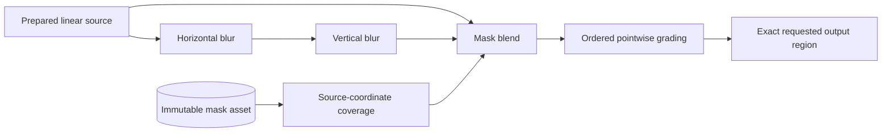

# Image-processing core research

Status: **research only; migration decision deferred**. The branch starts at `1fc4adaa014ba067e59b5e012c909cc721e3ecda` on clean `main`. Production editing, rendering versions, numerical thresholds, the typed bridge, history, and disabled controls are unchanged. There is no node editor, runtime plugin loader, or new application feature.

The experiment asks whether a region-aware internal graph can retain photographic detail and accommodate spatial/local operations while improving interaction and background completion. A faster blurred frame is not evidence of a better editor. Higher CPU/GPU utilization is not an acceptance criterion by itself.

## Findings and decision

Mac and Linux both expose a detail/performance tradeoff. The RX 7900 XTX can sustain normal-detail 60 Hz in the isolated shader lab, but loses 95 of 240 normal Fit inputs per run at the large-layout 120 Hz load. The actual application Exposure gate fails sustained progress, and draft frames still lose substantial detail. Native ECC fails numerical equivalence on both machines; Linux LibRaw passes the same fixture that failed on Mac. Dawn and wgpu agree with each other on the paired neutral proof but share a small exact CPU-reference failure. None of these observations justifies a language, GPU-backend or production-processing migration.

The recommended sequence is:

1. Keep TypeScript/React and the current typed application service. Preserve Dawn and exact rendering. The Linux component gains below do not establish a service or backend migration winner.
2. Resolve the shared full-source GPU reference miss and native SIMD-dependent ECC differences under the existing tolerances. Repeat on Mac with the committed Sony sources before treating either component as portable.
3. Profile application input/history, histogram publication and tile/fence boundaries at controlled, achieved input cadence. Retain normal detail and valid sharp navigation tiles; missing presentations count alongside latency. Finish the remaining slider/100% matrix and matched idle-Electron export control.
4. Prototype a Linux native encoder worker adapter as an isolated candidate, with original-size reconstruction, fallback, cancellation and durable-publication checks. Existing Linux exports spend a median 3.640 s in HDR encoding; a tiny codec result is insufficient to predict full-job savings. Keep the Mac four-second failures and Linux missing-backend result visible.
5. Use the internal graph contract for retained decoded/linear sources, explicit color/geometry boundaries, bounded mask assets and spatial dependency regions. Address merge I/O, memory admission and foreground capacity before integrating concurrent work; measure actual jobs rather than pointwise service throughput.
6. Evaluate DMA-BUF/IOSurface transport independently, including ownership and failure cleanup. The paired wgpu compute study is useful parity evidence, but needs application/HDR presentation and fallback verification before any backend proposal.

These are recommendations from the code audit and local experiments, not a measured application speedup or an approved migration.

## Bazzite component observations — October 16, 2026

The continuation started from clean `c69c40fa12c7936bfe6804820710d4238e7cbeb3` on the existing research branch. Measurements record that revision plus the dirty research worktree and relevant source hashes. Production code, rendering references, tolerances and disabled controls are unchanged. `package-lock.json` remains unchanged (`6ac6b36ef26377fef46aed14622108c2c1155e64bc5bf437d488b51243202f05`).

The host is Bazzite GNOME 44.20261012.0, kernel `7.2.9-ogc3.1.fc44.x86_64`, Ryzen 9 7900X3D (12 cores/24 threads), 32,681,103,360 usable RAM bytes, and Radeon RX 7900 XTX (`1002:744c`, amdgpu, RADV Mesa 26.2.4; Vulkan loader 1.4.341, adapter API 1.4.354). The integrated Radeon is also present; measured hardware adapters identify the discrete GPU. This is the host desktop, without a toolbox/container. The power profile reports **performance**, using tuned, with no reported degradation; governor and energy preference also report performance. Filesystem and driver caches were not purged.

GNOME Wayland uses the primary MSI MAG342CQR at 3440 × 1440, scale 1, 143.9999 Hz, with BT.2100/HDR enabled in the saved and active compositor configuration. The secondary LG is 1920 × 1080, scale 1, 74.9725 Hz, SDR. Monitor capability is not a luminance measurement. VRR operation is not independently verified. Requested native content sizes remain 1100 × 700 with Console open and 1440 × 900 with Console closed; per-case evidence records the actual viewport, DPR, screen metadata, adapter and cadence.

The shell has Node 26.7.0/npm 11.19.0; the main npm verification commands use bundled Node 24.20.0, while direct focused Playwright and the final RAW/UI/export invocation use host Node 26.7.0. Processing workers retain bundled Node 24.20.0. Per-invocation evidence records the orchestrator runtime; these are both supported Node 24+ configurations, not identical hosts. Electron is 44.3.0, Chromium 152 and native Dawn binding `webgpu` 0.6.1. Homebrew supplied Rust 1.99.0/LLVM 23.1.2, CMake 4.4.4 and NASM 3.02; GCC is 16.2.1. Setup also upgraded Homebrew dependencies, recorded in `artifacts/research-bazzite/brew-after.txt`; no OS graphics packages or display modes were changed. All four native archives matched the hashes below. OpenCV uses pthreads and SSE/SSE2/SSE3 baseline with optional SSE4/AVX/AVX2/AVX512 dispatch; the other disabled backends remain disabled.

The first research HDR build failed because GCC did not receive `<cstdint>` through the transitive headers used on macOS. The research-only Linux compiler invocation now supplies `-include cstdint`; the production bridge remains byte-for-byte unchanged. Failed compiler output and successful manifests remain in `artifacts/research-bazzite/`. The wgpu helper's initial API/build and sandbox-version-capture failures are also retained.

### Native equivalence and portability

| Component                          | Linux result                                                                                                                  | Thirty-observation timing boundary                                                                                                                    |
| ---------------------------------- | ----------------------------------------------------------------------------------------------------------------------------- | ----------------------------------------------------------------------------------------------------------------------------------------------------- |
| LibRaw 0.22.1                      | **Passed**, maximum/mean difference and fraction above two codes all zero                                                     | WASM warmed-module/fresh-decoder median/p95 1168.8/1195.7 ms; native launch + input/output 920.0/941.4 ms; native completed processing 831.0/849.6 ms |
| OpenCV 4.13.0 ECC                  | **Failed**, maximum matrix difference `0.008096393197750948`, repeated unchanged at 1/2/4 threads and on the exact case rerun | WASM median 136.5 ms; one-thread native launch median 74.4 ms. Faster mismatching output is not equivalent.                                           |
| Ultra HDR 2.0.2 / jpeg-turbo 3.1.0 | Passed dimensions, metadata and reconstruction; maximum half-code difference zero                                             | WASM median/p95 5.9/6.3 ms; one-thread native launch + input/output 8.0/9.5 ms; native compute median 3.61 ms                                         |

The exact Linux LibRaw result does not erase the Mac maximum-589 failure or certify other cameras. The codec workload is 256 × 192, not an original-size export candidate. Linux production still uses WASM encoding; the research helper does not activate native encoding in the application.

A one-shot ECC correctness diagnostic held the input, masks, algorithm, thread count and strict `1e-3` gate fixed. Default dispatch differed by `0.0080963932`; disabling AVX512-SKX reduced this to `0.0021635583`; disabling all optional compiled dispatch paths reduced it to `4.06e-12`. This implicates dispatched arithmetic in iterative convergence. The default optimized helper and its failures are preserved. Single diagnostic timings are not a throughput comparison or approval to replace the existing alignment bridge. Full matrices, disabled feature names, source/build hashes and stderr are in `artifacts/research-bazzite/ecc-dispatch-diagnostic/diagnostic.json`.

### Detail, batching and CPU transport

The unchanged native Dawn component calibration uses the same synthetic source, viewport, DPR and 30-observation method as the Mac component study. It measures completed queue work, separately from Electron input/presentation.

| Normal detail batch | Histogram | Median / p95 completed work |
| ------------------- | --------- | --------------------------: |
| 8, per-batch waits  | Off       |            5.477 / 5.595 ms |
| 8, per-batch waits  | On        |            3.729 / 6.115 ms |
| 32, final fence     | Off       |            2.121 / 2.799 ms |
| 32, final fence     | On        |            1.914 / 2.043 ms |
| 128, final fence    | Off       |            1.493 / 1.876 ms |
| 128, final fence    | On        |            1.545 / 1.590 ms |

Draft batch-32/histogram-on measured 0.481/0.495 ms. Ordered trials are nonmonotonic: histogram-on sometimes measures faster, so this does not identify a causal histogram improvement or universal batch optimum. Valid retained sharp navigation measured 0.098/0.145 ms versus 1.562/1.689 ms when fresh, with zero rerendered tiles in the retained case.

The existing fine-pattern and photograph proofs pass exact tolerance with maximum error/tolerance ratios 0.819 and 0.167. Draft edge-energy retention remains only 0.0772× and 0.4731× respectively. The LUT's real-photo 17³/33³ mean errors remain 0.0241/0.00629 and maxima 0.1187/0.0391. Neither low draft latency nor LUT throughput approves lost detail or an approximation.

C++ and Rust retain byte-identical ordered-kernel results, a 12 MiB owned buffer per service and 24 MiB plus 64 protocol bytes transferred per photograph. Five fresh launches had medians 31.38/29.86 ms. For one photograph/one compute thread, median/p95 round trips were C++ 14.13/21.88 ms and Rust 10.72/15.69 ms; with four threads, 11.22/16.24 and 12.08/12.92 ms. Two photographs/four aggregate compute threads achieved 111.85 and 91.96 photographs/s. Cancellation settled in 1.30–2.83 ms, including process termination/transport. Variability, ownership copies and this small kernel workload prevent a language or full-service ranking.

### Paired Dawn/wgpu compute experiment

`research-wgpu` pins wgpu 30.0.1 with a Cargo lockfile and separately built helper. It uses identical hashed production WGSL, Float32 source/ACES tables, uniforms and jobs on the same RX 7900 XTX Vulkan adapter. Both runners evaluate all 176 source tiles of a 1024 × 684 synthetic pattern, using three repetitions of 30 observations per batch after five warmups. This differs from the viewport planner's visible subset; compare only the paired rows in this experiment.

| Batch              | Dawn medians across three repetitions | wgpu medians across three repetitions |
| ------------------ | ------------------------------------: | ------------------------------------: |
| 8, per-batch waits |              5.942 / 5.501 / 5.932 ms |              4.677 / 4.351 / 4.335 ms |
| 32, final fence    |              2.120 / 1.948 / 1.950 ms |              1.952 / 1.929 / 1.879 ms |
| 128, final fence   |              1.704 / 1.709 / 1.689 ms |              1.687 / 1.682 / 1.656 ms |

The exact case rerun retained variation: batch-128 medians were Dawn 2.139/1.760/1.740 ms versus wgpu 1.644/1.610/1.602 ms. Wgpu's first shader/pipeline setup was 283.6 ms versus 2.55 ms on the rerun; uncontrolled driver caches matter. Large batches are close, and smaller-batch native host/fence overhead differs. Fixed Dawn-then-wgpu ordering, different JS/Rust host waits and no application presentation prevent a backend migration conclusion.

**Both invocations failed the unchanged exact CPU-reference gate.** The full-source neutral proof's maximum error/tolerance ratio is `1.0402200467503917` in both backends. All compared original-pixel Float32 RGB values agree between backends, with zero alpha difference; parity is narrower than reference acceptance. An offline CPU-only audit found exactly one failing pixel/channel among 700,416 pixels and 2,101,248 RGB samples, with no nonfinite values. At (2, 655), red was 0.017558438703417778 versus CPU 0.017560884487192924: absolute error `2.4457837751457046e-6` exceeds tolerance `2.3512176897438586e-6`. The denser source lattice exposes a shared numerical miss absent from the smaller passing proof. Timed exposure outputs are not all read back. Preserve this failure before further optimization. The experiment excludes histogram, mips, planner/cache reuse, canvas, React/history, shared textures and hardware timestamps. Retained owned GPU bytes are 29,078,272, plus a separate untimed 14,868,480-byte readback allocation; these are not peak VRAM.

### Resource method

The research-only Linux wrapper samples owned process trees through `/proc`, retains PID/TID start-time identities and exited observations, and records sampler overhead. CPU sums own process `utime+stime`, excluding accumulated child CPU. I/O uses individual `/proc/pid/task/tid/io` records: process-level I/O also includes reaped children and would double-count them. The [kernel's separate thread/group accounting](https://code.googlesource.com/linux/torvalds/linux/+/0c59ae1290741854b6cf597ef05bfa9bc811389f/fs/proc/base.c) motivates that choice. Three registered fast cases cover parsing, descendants/reuse and exited/partial counters.

The component invocation sampled 2.324 GiB maximum summed RSS, 85 live threads and 9 live processes, with 183.86 observed CPU-seconds. Logical reads/writes were 24.795/20.809 GiB, while kernel storage accounting reported only 11.84/582.60 MiB. Pipes, caches, tmpfs and repeated output replacement explain why logical counts must not be labeled physical disk traffic. The sampler used 5.73 CPU-seconds over 134.3 s, at 250 ms requested intervals and 268.8 ms maximum observed gap. These are instrumented whole-invocation totals including static checks/builds, not per-export CPU or candidate peak-memory rankings. Missing short-lived work makes CPU/I/O partial; summed RSS counts shared pages repeatedly. Exact peaks, unique physical memory, job-attributed VRAM and physical storage-device traffic remain unmeasured.

The initial graph/protocol selection passed 273 cases in 21.84 s. The component selection recorded 277 passes and the retained ECC failure in 134.16 s. Its exact ECC rerun failed again in 19.39 s. The paired backend selection recorded 268 passes and one failed numerical case in 23.03 s; its focused rerun failed again in 3.54 s. Counts include repeated cheap checks. An earlier component invocation was blocked at formatting before any measurements; its failed evidence remains. No comprehensive checkpoint was run.

### Actual foreground cadence and retained detail

The initial ten-case presentation selection passed 278 cases including cheap checks in 370.15 s. It retained all 17,280 input presentations without regressions, but its requested 60/120 Hz streams actually delivered only 47.998–48.042/71.988–72.001 Hz. Restarting each delay at the last native frame rounded every interval up to three/two frames on this 144 Hz display. Those timings remain valid only for the lower delivered loads.

The research-only scheduler now accumulates deadlines from the first native frame and sends at most one input per frame. Six pure cases cover the 144 Hz timing model, unsupported cadence ceilings, duplicate timestamps, stalls, actual dispatch metrics and completeness. After the measured rerun, completeness was tightened to require both native mean cadence and every achieved input stream to reach at least 99% of the requested Hz. The saved corrected streams satisfy this rule; no extra GPU repetition was used to obtain a pass. The affected four-case rerun passed in 246.13 s, after 273 fast cases/static checks passed in 16.69 s. It delivered actual averages **59.9569–59.9599 Hz** and **119.9077–119.9257 Hz**. Native rAF medians were 6.9 ms. Inputs retained 13.5–21.3 ms intervals at 60 Hz and 3.2–15.1 ms at 120 Hz, including native-frame quantization and dispatch jitter; these are not uniform 16.67/8.33 ms streams. Electron's native display API reported frequency zero/unknown; Mutter's active mode and measured rAF provide the separate cadence evidence. Electron uses the existing native Wayland/Vulkan switches under GNOME Shell 50.5, rather than XWayland.

Each table cell retains all three 240-input normal-detail runs. Latencies end after completed GPU work and a following animation frame. All publication serials were monotonic.

| Window / requested input rate      |        Normal Fit p95 | Missing Fit inputs |    Normal 100% p95 | Missing 100% inputs |
| ---------------------------------- | --------------------: | ------------------ | -----------------: | ------------------- |
| 1100 × 700, Console open, 60 Hz    |    7.0 / 7.0 / 7.0 ms | 0 / 0 / 0          | 7.0 / 7.0 / 7.0 ms | 0 / 0 / 0           |
| 1100 × 700, Console open, 120 Hz   |    7.0 / 7.0 / 7.0 ms | 0 / 1 / 0          | 7.0 / 7.1 / 7.0 ms | 0 / 1 / 0           |
| 1440 × 900, Console closed, 60 Hz  | 14.0 / 14.0 / 14.0 ms | 0 / 0 / 0          | 7.0 / 7.0 / 7.0 ms | 0 / 0 / 0           |
| 1440 × 900, Console closed, 120 Hz | 14.0 / 14.0 / 14.0 ms | 95 / 95 / 95       | 7.0 / 7.0 / 7.0 ms | 1 / 0 / 0           |

Normal 800% p95 was 7.0–7.1 ms, with no missing inputs at 60 Hz and only two missing in one large-layout 120 Hz run. Draft p95 was 7.0–7.1 ms, with four missing inputs across all 120 Hz draft runs. Across the 72 sustained runs, 16,986 of 17,280 inputs reached presentation: **294 missing, zero regressions**. Large-layout normal Fit presented only 145 of 240 inputs per run at the 120 Hz load. Low surviving-frame latency does not establish sharp 120 fps. Normal-detail 60 Hz is locally feasible in this shader lab, which bypasses React/history; it does not certify the shared full-source numerical failure, other devices, physical input delivery or scanout.

Normal refinement after input took 5.9–9.5 ms. Warm navigation reduced completed compute medians to 0.4–0.5 ms with zero evaluated texels, versus 2.6–2.8 ms small-layout/4.9–5.0 ms large-layout fresh compute. Both fresh and warm presentation p95 remained about 7 ms at the compositor boundary. Valid same-revision reuse improves computation without establishing a comparable whole-frame wall-time gain.

Five fresh isolated application imports reached useful normal frames in **3237, 3450, 3482, 3433 and 3459 ms**. These include import/review and exclude main-process startup, with unpurged source/driver caches; they are separate from the existing-library selection benchmark's 3000 ms gate. Native prepared source dimensions were 5422 × 3622. The shader study's separately validated source read took 651–690 ms, upload/mips 321–334 ms, and total source request through study-ready 1010–1071 ms. Retained owned GPU allocations were 418–422 MiB, not measured peak VRAM.

The corrected four-case invocation sampled 66.91 CPU-seconds, 2.607 GiB summed RSS, 217 live threads/16 processes, 2.922/1.310 GiB logical reads/writes and 16.08 MiB/1.510 GiB kernel storage reads/writes. Sampler overhead was 14.58 CPU-seconds over 246.68 s, about 5.9% of one core. Actual maximum sampling gap was 271.7 ms; there were no observed task-I/O read failures. All resource scope/peak/traffic limits above still apply. Desktop libraries/profiles live on NVMe/btrfs through a task-owned temporary root, not this host's RAM-backed `/tmp`.

### Reusable real Sony sources

At the user's explicit request, [fifteen unmodified SD-card originals](../tests/fixtures/research-sony/README.md), totaling 312,617,984 bytes, are committed for offline Linux/Mac repeatability. The manifest records hashes, active/storage dimensions, numeric capture facts, source provenance and repository/testing authorization without inventing a general open-content license. It contains a twelve-frame fixed-exposure ZV-1A burst for distributed 2/3/5/9-source noise trials and one genuine three-frame HDR BRK capture. All copies matched both the card and the prior local hashes. The portable wrapper verifies every original before/after each selected command. The fixture manifest SHA-256 is `4e3e6a07767ede1df7f23b2b646146ea355af3b00a975575b32cbdff0769677f`. Generated measurements, crops, logs and native binaries remain ignored.

### Complete exports and actual foreground interference

The production background selection passed 275 cases in 297.30 s, including **30 original-size, quality-100 neutral Sony exports and three heterogeneous batches**, with zero export retries. Each Sony output is 5422 × 3622 and 40,709,148 bytes, using GPU source preparation/rendering and the existing WASM encoder. Individual median/p95 were **6.536/6.809 s**, range **6.380–6.859 s**. Mixed-batch totals were **8.157, 8.060 and 8.318 s**, each containing that RAW plus the two different committed 1920 × 1280 JPEGs. All source hashes and output dimensions were checked. Total published output across these jobs was 1,351,912,143 bytes.

Median diagnostics identify 1127 ms source preparation, 935 ms rendition, 532 ms SDR encoding, 3640 ms HDR encoding, 204 ms validation/write and 117 ms publication. Rendition includes GPU initialization, tiles and packing (130/523/198 ms medians); nested/overlapping stages must not be summed as independent costs. Known owned GPU allocations were 406,703,592 bytes; the reported encoder WASM heap was 840,105,984 bytes. This identifies encoding as a worthwhile isolated Linux candidate, without proving a native full-job gain from the tiny codec comparison.

Three actual Exposure runs without export had p95 **18.1/23.1/22.8 ms**, at measured input averages **68.47/51.54/51.62 Hz**. With export, p95 was **22.7/18.4/18.2 ms**, at **58.13/58.67/58.82 Hz**. All six presented every one of 240 inputs without regressions; every counted frame was **draft**, with normal refinement awaited separately. Every input in the export trials overlapped an active export. Those jobs completed in **10.907/11.006/11.006 s**, with 100 ms completion polling. Cadences differ, and there is no matched idle-Electron export-duration control: do not attribute the entire difference from the service-only 6.536 s baseline to input alone, or infer sharp 60 fps from this workload.

Whole-invocation resource lower bounds were 346.38 CPU-seconds, 3.548 GiB sampled summed RSS, 217 live threads/17 processes, 20.264/8.365 GiB logical reads/writes and 1.324 MiB/8.387 GiB kernel storage reads/writes. Sampler overhead was 13.76 CPU-seconds over 297.45 s, about 4.63% of one core, with 270.2 ms maximum sampling gap. Two observed processes lacked I/O and three task reads failed. These are not per-export CPU, physical traffic or exact memory peaks.

These neutral WASM exports remain distinct from the existing **edited-fixture four-second native-export gate**. Its repeated Mac failures remain in the Mac section below; Linux production has no native encoder adapter, so research helper availability cannot satisfy that gate's backend prerequisite.

### Existing application gates

The unchanged `hdr-slider-benchmark` + `hdr-interaction-benchmark` selection recorded **276 passes and one failure in 46.17 s**. All three navigation cases passed. Warm pan/zoom/native pointer-locked drag p95 were **14.1/19.5/14.2 ms**, with 40 samples after five warmups. Sustained warm horizontal/vertical/drag p95 were **26.8/21.2/26.1 ms**, with 41/41/44 normal presentations, unchanged histogram, source upload reuse and 10.4–12.9 ms refinement. Cold p95 were **44.4/34.0/46.7 ms**, with 28/30/30 presentations including 23/21/23 drafts, and 41.6–65.3 ms refinement. Existing cold gates require progress/refinement rather than a 33 ms cold p95. Exact input timestamps are absent from those navigation datasets; no 120 fps claim follows. The optional background-import workload was not enabled.

The slider case failed at the first **Fit Exposure** continuous workload: **23 completed frames and 23 matching histograms**, below the unchanged **30/30 minimum**. Its exact rerun failed again at **24/24** in 6.63 s. Both delivered 45 native-frame bursts of four events at measured 140.8 Hz over 312.5 ms, with 40 eligible post-warmup target values. Matched continuous frame p95 were **41.4/37.4 ms**, histogram p95 **25.4/26.6 ms**. Final edit, analysis and histogram serials agreed and the source uploaded once: this is reduced sustained progress rather than a stuck final state. Paced Exposure frame p95 varied from 27.9 to 34.8 ms between attempts. Later sliders and 100% were not reached, so the eight-slider matrix is **not verified**. No minimum count, numerical limit, latency limit or production control was changed to make it pass. Comparing this native-rate application workload with controlled shader-lab 60 Hz requires their actual cadence and quality labels.

### Real HDR correctness and export prerequisite

The committed three-frame HDR bracket passed the existing RAW measured-exposure/preparation test and foreground UI lifecycle test: review, native preview through the typed API/MCP, publication, opening, and surviving source deletion inside the isolated library. RAW and UI case durations were 36.56 and 51.57 s; these are whole-test durations, not isolated HDR processing throughput. The selected invocation recorded **276 passes, zero failures and one skip in 110.07 s**, exit **2/incomplete**. The edited original-size export case skipped because the bundled macOS arm64 encoder is unavailable on Linux. The research helper does not satisfy that production prerequisite. The four-second threshold and both prior Mac failures remain unchanged.

The HDR Float32 output and independently UI-published master matched byte-for-byte, SHA-256 `07f0c0ef1227aa0343cf2a875f9a591da2b200a3f37f6d7daff6a54afc689d07`, at 3654 × 5450. Measured exposures were −2.02528/+2.02440 EV. The single functional worker run took 35.139 s, including a reference-highlight CPU fallback with 12.860 s preparation plus 2.217 s decode alongside GPU preparation/accumulation/output. Reported worker RSS was 1628 MiB, owned GPU bytes about 889 MiB and scratch 3.799 GiB. This is functional diagnostic evidence, without a repeated HDR throughput claim or a newly passed speed gate.

The 1100 × 700 review screenshot, published preview and seven native 640 × 640 result/reference crop pairs were visually screened. No obvious new doubled edges, color fringe or tile/tone seams appeared in the sampled contours, people, bench, grass and curb; existing noise/optical softness remain. Deghost/reference decisions covered 39.0641%, with 0.06566% clipped-reference use. These are existing SDR proofs tied to the published master hash, not independent CPU master rendering, radiometric ground truth, whole-image quality acceptance or physical HDR certification. Inspection evidence is under the invocation's `visual-inspection/` directory.

The complete RAW/UI/export invocation sampled 162.60 CPU-seconds, 3.047 GiB summed RSS, 231 threads/19 processes, 12.110/9.627 GiB logical reads/writes and 0.938/8.257 GiB kernel storage reads/writes. Sampler overhead was 5.775 CPU-seconds over 110.52 s, about 5.23% of one core, with a 269.8 ms maximum gap and no observed I/O read failures.

### Real merge completion and scaling

The first `merge-benchmark` selection recorded 277 passes and eight RAW-case failures in 113.22 s. Its three prepared-synthetic cases passed, but RAW calibration/real cases failed before measurement because the test constructed metadata/capture workers from the unbuilt `src/main/preview-worker.js` path. The exact two-source rerun reproduced that infrastructure failure. The benchmark now injects the built `out/main/preview-worker.js` for both roles; production constructors and algorithms are unchanged. The first repaired repeated-two case passed in 37.14 s, and the remaining seven cases recorded five passes/two performance failures in 309.06 s.

Each cell lists three cold review-through-durable-publication observations. Sources/preparation are fresh per repetition, without purging filesystem/driver caches. The unchanged gate is **maximum ≤15 s**. Repeated-image calibration is separate from distinct original captures.

| Sources | Repeated original calibration, seconds | Real fixed-exposure noise sequence, seconds |
| ------- | -------------------------------------- | ------------------------------------------- |
| 2       | 7.507 / 7.541 / 7.787                  | 10.033 / 9.460 / 9.422                      |
| 3       | 8.275 / 8.391 / 8.330                  | 10.346 / 10.451 / 10.776                    |
| 5       | 10.567 / 10.579 / 10.583               | 13.782 / 13.849 / 13.852                    |
| 9       | 14.888 / **15.076** / 14.874           | **18.005 / 18.037 / 18.366**                |

The exact two-case nine-source rerun recorded one pass/one failure in 117.43 s. Repeated calibration measured 14.909/14.751/14.948 s, crossing from a near-threshold failure to a pass; this is variability, not a reliable margin. Real noise remained above the limit at **17.980/17.958/18.063 s**. Both attempts remain evidence. Publication generally took 717–822 ms. Separate strength-change reuse renders took 4.3–5.4 s for repeated calibration and are excluded from its cold gate clock; they cannot be substituted for cold performance.

The real sources are distinct, hash-verified 5422 × 3622 prepared outputs. Real nine-source diagnostics reported 826–1291 ORB matches, 756–1249 inliers, usable coverage 0.7559–0.7598 and 7–8 motion candidates. Native patch acceptance/rejection and moving-region counts are algorithm diagnostics, without independent visual/motion ground truth. Overlapping first-run stages included 1102 ms decoding, 5545 ms preparation, 3181 ms matching, 11720 ms native validation, 1651 ms accumulation and 3024 ms output; do not sum them. Sampled worker peak grew from about 950 MiB at two sources to 1517 MiB at nine, with about 860 MiB known owned GPU allocations. A real-nine cold job reported 4.554/3.913 GiB logical reads/writes.

The completed seven-case invocation observed 402.86 CPU-seconds, 2.077 GiB sampled summed RSS, 66 threads/six processes, 98.793/72.830 GiB logical reads/writes and 8.542/63.068 GiB kernel storage reads/writes. These totals also include separately measured repeated reuse passes and publication/copying. Sampler overhead was 13.61 CPU-seconds over 309.94 s, about 4.39% of one core; maximum gap was 267.4 ms, three processes lacked I/O and four task reads failed. Resource and attribution limits above apply.

Prepared synthetic 2/9/32-source cases measured worker-only 2.744/5.459/15.813 s and whole-case 6.568/18.632/59.232 s. They exclude RAW decode and durable library publication, so they do not pass or fail the real 15-second gate. Their reported logical reads were 2.235/7.229/22.402 GB, writes about 0.989 GB each, and scratch 1.663/4.020/11.767 GB. Real 32-source work, merge/export overlap and foreground editing during real merges remain incomplete.

### Linux evidence index

All paths below are local and ignored, relative to the repository. The compact index is `artifacts/research-bazzite/summary.md`, with derived component/presentation/background/application/merge/RAW compact JSON and corresponding `*-resources.json`. Counts are passed/failed/skipped per invocation, including overlapping cheap checks; they must not be summed into distinct coverage. Direct focused runs have `playwright/summary.json`; registered runs have `summary.md`.

| Selection / attempt                                                                                       | Pass / fail / skip | Seconds | Evidence under `artifacts/verification/`                                                |
| --------------------------------------------------------------------------------------------------------- | ------------------ | ------: | --------------------------------------------------------------------------------------- |
| Initial graph/native protocol selection                                                                   | 273 / 0 / 0        |   21.84 | `2026-10-16T11-39-12.966Z-benchmark-mjvPvS/summary.md`                                  |
| Component attempt blocked at formatting before measurements                                               | 0 / 0 / 0          |    8.71 | `2026-10-16T11-40-00.245Z-benchmark-GPjcM1/summary.md`                                  |
| Components, libraries and detail; LibRaw exact on Linux; default ECC failed                               | 277 / 1 / 0        |  134.16 | `2026-10-16T11-41-27.659Z-benchmark-fIisLn/summary.md`                                  |
| Paired Dawn/wgpu; shared exact-reference numerical failure                                                | 268 / 1 / 0        |   23.03 | `2026-10-16T11-47-50.148Z-benchmark-AC3MZh/summary.md`                                  |
| Initial presentation, five fresh imports and texture capability inventory; actual inputs only 48/72 Hz    | 278 / 0 / 0        |  370.15 | `2026-10-16T11-51-50.595Z-benchmark-k3XkLE/summary.md`                                  |
| Focused graph/resource/pacing checks                                                                      | 273 / 0 / 0        |   16.69 | `2026-10-16T11-58-43.746Z-check-ehRCPp/summary.md`                                      |
| Thirty neutral exports, three heterogeneous batches and Exposure during export                            | 275 / 0 / 0        |  297.30 | `2026-10-16T12-03-56.308Z-benchmark-8nG6cK/summary.md`                                  |
| Application gates: first Fit/Exposure continuous throughput failed; three navigation cases passed         | 276 / 1 / 0        |   46.17 | `2026-10-16T12-09-32.750Z-benchmark-JOUIRq/summary.md`                                  |
| Native-size prepared synthetic 2/9/32 passed; eight RAW cases failed before measurement due worker path   | 277 / 8 / 0        |  113.22 | `2026-10-16T12-13-34.551Z-benchmark-amYg6s/summary.md`                                  |
| Focused graph/resource/pacing checks after isolated harness updates                                       | 274 / 0 / 0        |   17.05 | `2026-10-16T12-19-46.217Z-check-MvV7hf/summary.md`                                      |
| HDR bracket service/UI passed; edited native-export benchmark skipped on Linux (incomplete, exit 2)       | 276 / 0 / 1        |  110.07 | `2026-10-16T12-42-32.016Z-benchmark-TNq0Da/summary.md`                                  |
| Exact ECC failure rerun; unchanged matrix difference                                                      | 0 / 1 / 0          |   19.39 | `playwright-1792151084280-b522c019-937f-4efc-b0a3-e4324b292705/playwright/summary.json` |
| Exact Dawn/wgpu failure rerun; unchanged exact-reference ratio                                            | 0 / 1 / 0          |    3.54 | `playwright-1792151370010-e2b214d2-1d46-4fd5-b48e-85befac010f9/playwright/summary.json` |
| Corrected absolute-deadline pacing; four presentation cases; actual 59.96/119.92 Hz                       | 4 / 0 / 0          |  246.13 | `playwright-1792151957051-f910bf1c-2f8b-4ac7-ad29-185765ba6437/playwright/summary.json` |
| Exact slider failure rerun; 24 frames and histograms below unchanged minimum 30                           | 0 / 1 / 0          |    6.63 | `playwright-1792152766953-99e2bbfe-e6b5-4a4e-b626-98863e071f72/playwright/summary.json` |
| Exact first merge failure rerun; missing built preview-worker path reproduced                             | 0 / 1 / 0          |    0.76 | `playwright-1792152997998-b9de2361-221a-4690-874c-d39b67efb77d/playwright/summary.json` |
| First fixed repeated-RAW two-source case; three trials passed                                             | 1 / 0 / 0          |   37.14 | `playwright-1792153096814-348acb75-eef0-4141-a5ad-b138d83f725b/playwright/summary.json` |
| Remaining seven merge cases; repeated nine-source and real nine-source exceeded 15 s                      | 5 / 2 / 0          |  309.06 | `playwright-1792153231776-9a0bf501-6d06-4541-b206-11a89a63c1d2/playwright/summary.json` |
| Exact two nine-source failure reruns; repeated passes narrowly, real still fails; prior failures retained | 1 / 1 / 0          |  117.43 | `playwright-1792154414618-662b503c-1379-4aa9-8772-a5f7fd0b0d29/playwright/summary.json` |

Machine/power/driver evidence is in `artifacts/research-bazzite/machine-before.json` and `machine-after.json`, with matching OS/kernel/graphics packages and power profile after measurements. `source-hashes-final.json` records repository/fixture hashes; native manifests retain archive/compiler/flags/binary identities. Setup/build/format failures, ECC dispatch diagnostics and the CPU-only worst-pixel audit remain alongside the index. `cleanup.json` records that only task compile/transform caches remained in the task temporary root; test profiles/libraries and owned application/processing workers were cleaned. Unrelated existing MCP helpers were preserved. No full/all checkpoint or production packaging certification was performed.

## Local M4 Pro observations

Measured on Apple M4 Pro (12 CPU cores, 16 GPU cores, 24 GiB), Darwin 25.6.0, Node 24.20.0, Electron 44.3.0 and Playwright 1.63.0. Experiments ran sequentially from the base revision above with a dirty research worktree; JSON records relevant source/fixture/lockfile hashes and native build manifests. Filesystem and driver caches were uncontrolled. The built-in workspace used device-pixel ratio 2. No physical scanout or luminance was measured.

### Detail and component cost

The native Dawn calibration uses a 1024 × 684 synthetic source, 914 × 502 CSS viewport, scale 1, and DPR 2. Each row contains 30 observations. Submission and completed-work boundaries are distinct; these are not Electron input latencies.

| Quality | Tiles/submission and waits | Histogram | Median / p95 completed work |
| ------- | -------------------------- | --------- | --------------------------: |
| Draft   | 8; wait per batch          | Off       |              1.82 / 4.16 ms |
| Draft   | 32; final fence            | On        |              2.52 / 2.62 ms |
| Normal  | 8; wait per batch          | Off       |            58.21 / 62.36 ms |
| Normal  | 8; wait per batch          | On        |            63.17 / 68.49 ms |
| Normal  | 32; final fence            | Off       |            51.47 / 52.26 ms |
| Normal  | 32; final fence            | On        |            56.32 / 57.04 ms |
| Normal  | 128; final fence           | On        |            55.26 / 56.48 ms |

Changing batching/waits reduces overhead but leaves this normal-detail workload above 33 ms. Histogram submission/readback adds measurable work; its mapping fence overlaps preceding rendering. These results do not establish the preferred cancellation policy or a production batch size.

The independent 192 × 128 high-frequency proof retains the unchanged exact GPU tolerance: maximum error/tolerance ratio **0.196**, with edge energy essentially equal to the CPU reference. The draft retains **0.0772×** reference edge energy and has mean absolute error **0.1865** in display-linear units. Its low latency comes with substantial lost detail. This synthetic edge-energy ratio is not a quality score for arbitrary photographs.

The added real-photograph calibration converts the licensed JPEG fixture to linear Rec.2020 and applies 4× exposure before exact ACES. Normal-detail maximum error/tolerance ratio is **0.0518**; draft edge energy is **0.4731×** reference, mean absolute error **0.1200**, maximum **1.5433**. It independently confirms the detail tradeoff on photographic texture, without certifying RAW color or the original authored JPEG rendition.

CPU preview LUTs remain a separate approximation experiment. On the real raster fixture, 17³/33³ LUT mean absolute errors were **0.0241 / 0.00629**, with maxima **0.1187 / 0.0391**, in display-linear units (1 = 100-nit reference white). Synthetic-pattern maxima were **0.2509 / 0.0628**. CPU evaluation was approximately 8.6–9.7 ms versus 33 ms for direct exact ACES at 192 × 128. This is not a GPU or application speed comparison. Neither LUT meets exact-rendering acceptance; generated contact proofs still require human visual review.

### Native correctness findings

| Component                | Local result                                                                                                                                                                     | Timing boundary and implication                                                                                                                                                                                                                                              |
| ------------------------ | -------------------------------------------------------------------------------------------------------------------------------------------------------------------------------- | ---------------------------------------------------------------------------------------------------------------------------------------------------------------------------------------------------------------------------------------------------------------------------- |
| LibRaw 0.22.1            | **Failed** maximum-two-code-unit research gate: maximum 589; mean 0.0000695; fraction above two codes `2.97e-7`. Worst sample: (2391, 863), red, native 46752 versus WASM 47341. | Thirty matching-version camera-linear decodes: WASM module-warm/fresh-decoder median 644 ms; native completed processing 443 ms; launch + file input/output 524 ms. Faster mismatching output is not equivalent. Investigate native/WASM compiler/SIMD/demosaic differences. |
| OpenCV 4.13.0 masked ECC | **Failed** `1e-3` matrix gate: maximum difference 0.005639553, repeated at 1/2/4 threads.                                                                                        | Thirty observations per thread setting: WASM about 121 ms; native launch about 50 ms, completed ECC about 46 ms. Extra threads did not materially improve this small calibration. This does not measure the custom patch-registration bridge or real merges.                 |
| Ultra HDR 2.0.2          | Passed dimensions, metadata and full reconstruction comparison; maximum half-code difference 0.                                                                                  | Thirty 256 × 192 encodes: WASM median 4.25 ms; single-thread native launch + input/output 4.50 ms. Tiny-job launch cost prevents an end-to-end benefit here. Linux and original-size candidate encoding remain separate measurements.                                        |

The LibRaw and ECC failures reproduced on diagnostic reruns without changing their tolerances. They are research findings, not regressions in production code. No native decoder/alignment migration is approved.

The final repeat measured LibRaw medians 637 ms WASM / 496 ms native launch-and-disk / 433 ms native processing. ECC measured 144 ms WASM and native launch medians 58 / 55 / 54 ms at 1/2/4 threads. Timing variation between invocations is retained; numerical differences were unchanged.

The unchanged edited-fixture export gate also failed during this research: fresh-worker p95 **6.946 s**, subsequent p95 **6.713 s**, against the existing **4 s** limit. The exact case rerun failed again at **7.127 / 6.437 s**. Both sets of 20 full jobs retained quality/dimensions, GPU source/rendering, native encoding and cleanup assertions. Individual source, GPU-tile and encoder stages varied together; their cause was not isolated. A power-status sample after the first failure reported AC power with the battery charging at 3%; thermal/power-warning counters were unavailable. This point-in-time sample does not explain the earlier runs. Preserve these failures alongside the prior four-second passes and earlier first-launch failure described in [testing](testing.md).

### Real work and first presentation

The production export baseline completed **30** original-size, quality-100 Sony RAW jobs and **three** heterogeneous batches (one RAW and two different JPEGs). Individual median/p95 were **3.705 / 4.308 s**, range **3.667–4.861 s**. Batch durations were **4.938, 5.018 and 5.057 s**. Output dimensions and original hashes were checked; export timings include durable publication and workers. This neutral-edit calibration does not replace the unchanged edited-fixture four-second export gate; the long tail remains visible.

At 1100 × 700 with Console open, three 240-input actual Exposure runs had p95 **18.1, 9.4, 17.4 ms** without export and **26.2, 9.3, 9.4 ms** with export. Missing presentations were 0/0/0 and 1/0/0. Every counted edit presentation was **draft**; normal refinement was awaited separately. Background jobs took **6.705, 6.204, 6.204 s**, measured with 100 ms completion polling. Foreground activity overlaps every input in these trials and slows background completion. This does not establish sharp 60 fps or interference for the other sliders or real merges.

Five fresh isolated application imports reached useful normal presentation in **2428, 2421, 2429, 2412 and 2411 ms**, reported individually. This clock includes fixture import/review and excludes main-process startup. The source and driver caches were not purged. Existing-library selection, fresh boot, fresh processing worker and cached revisit must not be combined under a single “cold load” number.

The final five-launch repeat measured **2443, 2456, 2459, 2491 and 2450 ms** under the same labeled conditions. Both cohorts remain available; no first-run outlier is removed.

The Electron capability inventory confirms shared-texture import/send APIs and the existing sandbox/context isolation, with Node integration disabled. No external-texture producer or transport benefit is established.

### Completed foreground presentations

The corrected research canvas uses production WGSL, validated managed RAW assets, `rgba16float` extended Display-P3, and production-equivalent device limits. A retained owned surface survives compute awaits; publication copies to the current canvas texture and fences completed work. Bounded upload strips do not remove Dawn's internal full-image initialization staging requirement. Initial request/texture-lifetime/limit failures remain in artifacts; their invalid frames are excluded from the results below.

Each cell reports all three 240-input runs. Latencies include the completed GPU work and following animation frame. Missing counts are essential: a low p95 among a small set of surviving frames does not establish the requested frame rate.

| Window / input rate                | Normal Fit p95, ms    | Normal 100% p95, ms | Missing Fit / 100%, per 240 inputs |
| ---------------------------------- | --------------------- | ------------------- | ---------------------------------- |
| 1100 × 700, Console open, 60 Hz    | 55.2 / 56.2 / 58.3    | 49.2 / 48.6 / 48.1  | 125 / 120 / 122; 93 / 89 / 86      |
| 1100 × 700, Console open, 120 Hz   | 50.2 / 48.6 / 48.9    | 42.2 / 39.4 / 42.5  | 179 / 179 / 177; 161 / 163 / 156   |
| 1440 × 900, Console closed, 60 Hz  | 142.2 / 134.6 / 142.6 | 84.2 / 84.4 / 84.6  | 197 / 206 / 206; 185 / 185 / 185   |
| 1440 × 900, Console closed, 120 Hz | 132.2 / 192.5 / 167.0 | 81.8 / 81.5 / 80.9  | 222 / 222 / 222; 207 / 208 / 207   |

The 800% normal-detail cases have a smaller visible source region. At 60 Hz their p95 is 16.9–17.6 ms with no missing inputs. At 120 Hz the smaller layout is 8.7–8.8 ms with 1–2 missing inputs; the larger is 17.9–25.2 ms with 108–112 missing inputs. All publication serials were monotonic. The native display reported 1800 × 1169 logical dimensions, scale 2, 120.0006 Hz and 30-bit color; measured idle rAF medians were 8.3–8.4 ms.

In the minimum-layout 60 Hz run, valid same-revision sharp navigation had warm p95 8.8–9.0 ms versus cold 25.2–31.1 ms over three 30-observation repetitions. This supports retaining valid sharp tiles for navigation, without mixing revisions. It does not prove cross-photo cold-load performance. These are shader-lab results; they bypass React/history and cannot replace the unchanged application benchmarks.

### Persistent CPU service transport

For 1024 × 768 RGBA Float32, the two ordered kernels produce byte-identical output in C++ and Rust. Each setting has three batches of 30 warmed observations, after five separately recorded fresh launches. Every photograph transfers 24 MiB plus 64 protocol bytes; one reusable native allocation owns 12 MiB per process.

| Aggregate compute threads / photos in flight | C++ median / p95 round trip | Rust median / p95 round trip | C++ / Rust photographs per second |
| -------------------------------------------- | --------------------------: | ---------------------------: | --------------------------------: |
| 1 / 1                                        |            11.30 / 12.07 ms |             10.71 / 13.43 ms |                       85.2 / 87.8 |
| 2 / 1                                        |            10.38 / 13.01 ms |              9.85 / 10.70 ms |                       88.7 / 95.7 |
| 2 / 2                                        |            12.10 / 13.32 ms |             11.79 / 13.04 ms |                     146.8 / 151.7 |
| 4 / 1                                        |             9.49 / 10.38 ms |              9.29 / 10.32 ms |                     102.2 / 104.7 |
| 4 / 2                                        |            11.11 / 12.39 ms |             11.04 / 15.27 ms |                     159.5 / 152.9 |

Single-thread compute alone was 2.31 ms C++ / 1.73 ms Rust; four threads reduced it to 0.62 / 0.47 ms. Transfer and ownership copies dominate the round trip. Two photographs improve aggregate transport throughput while increasing individual latency; real RAW/codec/GPU memory costs remain unmeasured for these candidates.

An earlier libc++ stream variant took approximately 185 ms per round trip despite similar compute. Disabling stream synchronization did not fix it. Replacing it with bulk POSIX read/write brought the C++ service into the same end-to-end range as Rust, retaining strict byte agreement. The earlier apparent language advantage was a transport implementation difference. This helper currently targets macOS/Linux; Windows transport is unverified.

Outstanding-request cancellation settled in approximately 0.9–2.4 ms; this includes transport and process termination, not a kernel-only checkpoint. Process RSS/thread counters are point-in-time samples including the shared test orchestrator and prior workloads, unsuitable for ranking candidate peak memory. No service migration or speedup in application exports follows from these two kernels.

Local evidence is retained under ignored `artifacts/verification/`:

- `2026-10-16T10-32-08.113Z-benchmark-syIlm4/summary.md`: static/build/265 fast cases passed; 19 research cases passed, four initial presentation-harness cases failed; 301.62 s. The JSON above comes from this run. Its original missing structured-attachment warning is retained; later harness commits add compact hashed measurement attachments.
- `2026-10-16T10-14-48.760Z-check-nqHtez/summary.md`: initial native/library measurements and unchanged two compatibility failures; 275 passed, two failed; 143.87 s.
- `playwright-1792146072916-12eda21a-ea65-49e6-b286-f624b759efe8/`: exact failing-case reruns for LibRaw and ECC with worst-pixel/all-thread diagnostics; both failed again.
- `playwright-1792147628852-9e662084-7214-4278-91f2-df76290e07f0/playwright/summary.json`: corrected minimum-layout 60 Hz case, one passed, 88.57 s, structured evidence attached.
- `playwright-1792147796412-3af41981-c834-457f-8be5-1b5c2e616c45/playwright/summary.json`: remaining layout/cadence cases, five fresh launches and capability inventory, nine passed, 207.57 s, no skips.
- `2026-10-16T10-55-49.343Z-benchmark-9pagYH/summary.md`: final graph/native/measurement/GPU selection, including real-photograph detail and bulk C++ transport, **277 passed**, no failures/skips/incomplete warnings, **43.85 s**. Type checking, lint, formatting and build passed; twelve exclusive research cases followed 265 fast cases.
- `2026-10-16T10-57-14.212Z-benchmark-WkC0kG/summary.md`: unchanged eight-slider Fit/100% and navigation gates, **269 passed**, no failures/skips, **63.27 s**. These gates permit drafts and do not establish retained detail.
- `2026-10-16T11-00-42.608Z-benchmark-XmHlIN/summary.md`: unchanged original-size edited HDR export gate, **265 passed, one failed**, **129.68 s**; both measured export p95 values exceed the preserved four-second limit.
- `playwright-1792148636653-053b1c3b-d4da-4c03-b456-0225e5185e1b/playwright/summary.json`: exact export failure rerun, one failed again, **123.10 s**, all 20 observations retained.
- `playwright-1792148836917-27d04ec7-1609-4d62-a36c-25230d8022df/playwright/summary.json`: final LibRaw/ECC failure reruns with embedded build manifests and structured attachments, two failed at the same numerical differences, **57.36 s**.
- `2026-10-16T11-11-49.710Z-benchmark-jleswI/summary.md`: final static/build/fast graph/native protocol selection, **270 passed**, no failures/skips, **15.2 s**, after the evidence-manifest changes. No comprehensive checkpoint was selected.

## Existing behavior and measurement boundaries

`src/renderer/src/preview/hdr-presenter.ts` computes a draft mip level from the visible source footprint and approximately 8,192 source pixels. Normal detail follows `hdrCachePlan`, independently of Retina density. A cold navigation request can use a draft; valid normal navigation tiles can survive continued input. `HdrRenderCache.setEdits` retires edited After tiles and retains neutral Before tiles. Content/SDR target identities are separate.

The presenter submits at most eight render tiles before a completion wait/cancellation check. Histogram work precedes the draws; histogram mapping after the draws also fences completed rendering. These costs overlap. A histogram-map fence is not a pure measurement of histogram execution. The research component probe records invalidation CPU time, command submission, batch waits, final completion, histogram submission, and map/fence time separately, and compares histogram on/off.

Existing slider benchmarks exercise all eight enabled HDR sliders at Fit and 100%, including sustained input and histogram completion. They permit draft quality. They remain unchanged; their speed gates do not certify retained detail. Existing preview/adjustment/HDR/export/merge benchmarks remain independently selectable through the existing verification runner.

## Internal operation contract

[Contract](../scripts/research/pipeline/contract.ts), [executor](../scripts/research/pipeline/graph.ts), and [repository operation modules](../scripts/research/pipeline/operations.ts) are isolated under `scripts/research/`. Production main, preload, renderer entry points, and clients do not import them.

Each recipe node declares operation/version, JSON parameters, named input/dependency IDs, output dimensions/channels, color domain, Float32 precision, alpha semantics, coordinate identity, and a cache/fusion boundary. Operation modules declare validation, CPU implementation identity, optional GPU implementation identity, the input regions required for an output region, and any immutable asset references. The reference executor runs CPU implementations only; the separate GPU experiment uses existing production WGSL. A declarative GPU identity alone does not implement a graph GPU backend.

The recipe stores intelligible edits and asset hashes. Execution plans, tile buffers, reductions, native processes, GPU textures, and caches are derived. Current settings are preserved verbatim by `adaptLegacy`, which requires pixels already prepared by the current pipeline. It deliberately does not reinterpret unsupported current adjustments as new graph operations. There is no catalog migration.

The masked-blur/grading proof composes these existing modules through the same executor:



The demand-driven model has precedent in [libvips regions, partial images, and operation caching](https://www.libvips.org/API/current/how-it-works.html). This prototype is an independent reference executor, not a wrapper around libvips or a decision to move Luma into its GObject runtime.

### Execution and invalidation

- The executor traverses named dependencies, rejects cycles/unknown versions/incompatible contracts, and pulls bounded regions. A streaming analysis reduction declares the full input dependency but consumes one tile at a time.
- Cache keys include operation/version, parameters, dimensions/domain/precision/alpha/coordinates, exact policy, requested region, and dependency identities. Revision numbers identify publication requests; identical pixel recipes can be reused at a later revision. Purpose is not a pixel transform: exact preview/export evaluate the same recipe.
- Mask fingerprints preserve zero-coverage tiles outside both old and new mask support. Downstream dependent keys change only where their requested regions see changed input content. Source and reusable upstream results survive downstream grading/mask changes.
- Compatible single-input pointwise chains fuse in order, with explicit Float32 rounding at each former intermediate. Shared or explicitly reusable nodes remain cache boundaries. Spatial filters, geometry, blends, and reductions are barriers.
- Separable blur declares source-pixel halos independently for each pass. Geometry declares inverse orientation, radial mapping, crop, and bilinear support. The radial prototype bounds its supported polynomial including optical-center edge extrema; it is not an arbitrary transform bound or a Sony lens provider.
- The bounded LRU pins dependencies during evaluation and recycles evicted allocations. The budget includes cached, pooled, live dependency, and current output buffers. The owned decoded source and outputs retained by the caller are reported separately. This is not an aggregate process-memory guarantee.

The reference executor currently accepts native scale and exact policy only. It explicitly rejects unsupported scale/approximation requests. A production graph still needs costed CPU/GPU partitioning, device resources, asynchronous tile delivery, buffer/transfer leases, and measured mip/approximation implementations. Implementing a module does not certify it for production.

### Masks, history, and geometry

The prototype follows [local-adjustment requirements](features/local-adjustments.md): masks use versioned normalized source coordinates, coverage is independent of photographic alpha, and feather radius is measured in source pixels using the smaller source dimension. The radial mask is an immutable content-addressed asset. `DurableMasks` stores JSON outside disposable tile caches, verifies its hash on read/orderly restart, and computes retained references across all current/undo/redo snapshots. Missing or corrupt history content is an explicit error. Crash-atomic publication/fsync, a production mask/history service and garbage collection are not implemented.

Orientation/lens/crop transform the photograph and mask using explicit inverse maps. Pointwise adjustments and blur preserve photographic alpha; the research geometry kernel interpolates straight channels. Transparent spatial filtering and premultiplied resampling need their own versioned semantics before production use. The CPU proof covers registration, order, feathering, tile seams, and the declared bounded radial geometry; it does not validate physical lens calibration, brush pressure, or arbitrary distortions.

### Extensibility proofs

| Workload                                 | Executable proof                                                                                                              |
| ---------------------------------------- | ----------------------------------------------------------------------------------------------------------------------------- |
| Exposure → grading                       | Order matters; fused and unfused Float32 results agree; reusable exposure/source survives grading changes.                    |
| Feathered mask + local exposure          | Separate coverage, source coordinates, preserved photo alpha, and localized invalidation.                                     |
| Blur at radii 0, 1, 3, 9 source pixels   | Two-pass dependency halos; fixed `5e-7` agreement against an independently computed untiled 2D filter, including edges/seams. |
| Masked blur → grading                    | Spatial and pointwise composition through the same executor and frame contract.                                               |
| Mask through orientation/lens/crop       | Four orientations and supported positive/negative radial mappings checked against independent coordinate calculations.        |
| Histogram → exposure parameter → grading | Full-image analysis streams once; downstream grading reuses it; upstream changes rerun it.                                    |
| Two image inputs                         | Named multiple-image dependencies and deterministic mean composition; not an HDR merge algorithm.                             |
| Additional sharpening module             | A test registers a new neighborhood operation without editing executor, scheduler, cache, or renderer transport.              |

## Candidate comparison

Rank by correctness/retained detail first, extensibility second, then interactive latency, background completion, resource efficiency, and maintenance cost. A candidate without equivalent evidence stays unranked on that criterion.

| Candidate                                               | Evidence and portability                                                                                                                                                                                                            | Maintenance and decision                                                                                                                                                                   |
| ------------------------------------------------------- | ----------------------------------------------------------------------------------------------------------------------------------------------------------------------------------------------------------------------------------- | ------------------------------------------------------------------------------------------------------------------------------------------------------------------------------------------ |
| Current TypeScript service + targeted native components | Existing production semantics remain the reference. The research C++ helper, native LibRaw/ECC, and native HDR encoder isolate particular boundaries. Cross-platform packaging and dependency licenses remain required.             | First candidate for an incremental measured change because it retains the application service and existing references. This is a risk/maintenance recommendation, not a throughput win.    |
| Rust/Rayon service                                      | Same owned Float32 frame protocol and ordered arithmetic as C++. Persistent local Rayon pool; bounded thread counts; five worker launches and warmed/repeated jobs. Rust does not eliminate native-library FFI or transport copies. | Useful ownership/scheduling candidate. Full RAW/color/geometry/codec equivalence and end-to-end gains are not established by two pointwise kernels.                                        |
| C++ service                                             | Equivalent persistent service; bounded persistent pool; reusable owned allocation. Direct C++ library integration can avoid some language/FFI crossings.                                                                            | More manual lifetime/cancellation/ABI work. Matching versions, SIMD, library thread pools, and platform link dependencies need explicit control. No full-service migration recommendation. |

The protocol has a fixed 32-byte request header (magic, dimensions, request ID, Float64 EV/curve parameters), bounded little-endian interleaved RGBA Float32 payload, and a matching response carrying completed compute time and owned capacity. It accepts no filenames, commands, shaders, or native handles. One service accepts one request; two-photo trials use two processes with a fixed aggregate compute-thread budget. Pipe transfer/copy cost is included in end-to-end timing and byte counts.

[Rayon's local thread-pool builder](https://docs.rs/rayon/1.12.0/rayon/struct.ThreadPoolBuilder.html) supplies the bounded Rust pool. The cooperative research scheduler prioritizes queued foreground work between bounded steps, caps admitted jobs at two, yields to the event loop, and closes cancelled generators. At capacity it rejects new requests, including foreground requests; this is an admission/cancellation proof, not a production foreground policy. Reserved foreground capacity or resource-releasing preemption and application-wide codec/library thread budgets remain required. Its synthetic tests do not establish protection during real exports/merges.

### Equivalent library comparisons

- LibRaw compares the installed WASM **0.22.1-Release** with matching native camera-linear 16-bit output, same AHD/white-balance/gamma/brightness settings and source fixture. Native file read/output and process launch are labeled separately from a warmed WASM module. A version mismatch leaves equivalence incomplete. [LibRaw documents the processing parameters](https://www.libraw.org/docs/API-datastruct-eng.html); the prototype is not a new camera decoder.
- OpenCV compares the existing masked `findTransformECCWithMask` call with the same native **4.13.0** call, masks, homography, stopping criteria and Gaussian size. One thread precedes 2/4-thread trials. Independent Accelerate/LAPACK, Carotene and KleidiCV paths are disabled in the fallback source build to avoid uncontrolled extra backends. The custom WASM SIMD patch-registration kernels are **not ported or measured** here. Native ECC alone cannot establish a merge speedup. [OpenCV's threading model](https://docs.opencv.org/4.13.0/d7/dff/tutorial_how_to_use_OpenCV_parallel_for_.html) does not account for unrelated libraries' pools.
- Ultra HDR compares the same unchanged bridge and pinned **2.0.2 / libjpeg-turbo 3.1.0** sources. A research-only source copy caps `GetCPUCoreCount` at 1 before any 2/4-thread build. Production/vendored binaries are untouched. Dimensions, full-size gain map, metadata and reconstructed half-float output are checked. Both machines now have the small component comparison; Linux original-size native export integration remains incomplete. [Upstream libultrahdr](https://github.com/google/libultrahdr) remains the codec reference.

### Shared textures and wgpu

Electron 44 exposes experimental shared-texture import/send APIs. The separate test inventories these and checks the existing sandbox/isolation preferences. An API being present does not establish transport throughput. [Import/release lifetime](https://www.electronjs.org/docs/latest/api/shared-texture), [texture metadata](https://www.electronjs.org/docs/latest/api/structures/shared-texture-import-texture-info), and [platform handle types](https://www.electronjs.org/docs/latest/api/structures/shared-texture-handle) define the next producer/receiver experiment.

The current Node Dawn binding has no tested producer/export ownership path for this experiment. A native IOSurface/Mach-port producer on macOS and DMA-BUF producer on Linux, synchronization, receiver death, stale generations, format/alpha/color preservation, and all-reference release remain incomplete. Do not expose handles through `window.luma` or MCP to bridge this gap. Continue using validated typed assets/frames.

[wgpu](https://docs.rs/wgpu/30.0.1/wgpu/) is a separate native Rust WebGPU implementation with platform backends. This PR retains Dawn. The Linux paired compute experiment above holds shader/input/adapter/completion boundaries constant and records host differences; its shared exact-reference failure remains unresolved. Wgpu application/HDR presentation, external-texture transport and fallback certification remain incomplete.

## Reproduce

Node 24+, npm dependencies and the existing Electron runtime are prerequisites. New Node tests use the registry; native/component workloads are exclusive and sequential. Electron uses the shared isolated launcher and temporary profiles, never a user library. Presentation cases require explicit foreground mode. No comprehensive checkpoint is implied.

The [Bazzite continuation brief](performance-research-bazzite.md) contains the Linux checkout, completed host setup, pinned native builds, committed Sony sequences, test matrix and remaining work.

```sh
npm ci
npm run setup:electron
npm run research:pipeline
npm run verify -- --plan --target research-measurements --target research-libraries --target research-gpu

# Research C++ service; no library development packages required.
node scripts/research/build-native.mjs pointwise

# Rust toolchain already installed. Keep all build output outside source.
node scripts/research/build-rust.mjs

# Either matching development packages + pkg-config, or these pinned source archives.
mkdir -p artifacts/research-build
curl --fail --location https://www.libraw.org/data/LibRaw-0.22.1.tar.gz --output artifacts/research-build/LibRaw-0.22.1.tar.gz
curl --fail --location https://codeload.github.com/opencv/opencv/tar.gz/refs/tags/4.13.0 --output artifacts/research-build/opencv-4.13.0.tar.gz
node scripts/research/build-native.mjs libraw
node scripts/research/build-native.mjs opencv

# Reuse verified source.tar.gz/jpeg.tar.gz under artifacts/ultrahdr-native-build.
# On macOS these are fetched by the existing build:export-native command.
# Linux: download the same pinned archives there; see the hashes below.
node scripts/research/build-native.mjs hdr-1

npm run research:measure
npm run research:presentation -- --foreground

# Keep actual React input/history behavior and its original gates separate.
npm run verify -- --foreground --target hdr-slider-benchmark --target hdr-interaction-benchmark
```

`LUMA_RESEARCH_CARGO` selects the Cargo executable for an isolated toolchain. `LUMA_RESEARCH_PINNED_SOURCES=1` selects verified LibRaw/OpenCV archives even when pkg-config finds system packages; a mismatched system version is rejected. `LUMA_RESEARCH_RUST_BINARY`, `LUMA_RESEARCH_LIBRAW_BINARY`, `LUMA_RESEARCH_OPENCV_BINARY` and `LUMA_RESEARCH_HDR_1_BINARY` can select explicit research helpers; default paths are under `artifacts/research-build/<platform>-<arch>/` or `artifacts/research-rust/release/`. Helpers have adjacent build manifests. No binary is installed into the application. `CXX` selects a compiler executable, not a shell command.

The build helper verifies SHA-256 before extracting fallback sources:

| Archive             | SHA-256                                                            |
| ------------------- | ------------------------------------------------------------------ |
| LibRaw 0.22.1       | `a789dc4e2409e2901d93793a4e0b80c7b49d0d97cf6ad71c850eb7616acfd786` |
| OpenCV 4.13.0       | `1d40ca017ea51c533cf9fd5cbde5b5fe7ae248291ddf2af99d4c17cf8e13017d` |
| libultrahdr 2.0.2   | `aa8d193bb887c348c419780511dd03b374f4e07af8812b6d3f80c8537cf1ef2c` |
| libjpeg-turbo 3.1.0 | `35fec2e1ddfb05ecf6d93e50bc57c1e54bc81c16d611ddf6eff73fff266d8285` |

Only local developer tools and downloaded source archives are needed for research builds. LibRaw's single-thread fallback uses upstream `Makefile.dist` without optional JPEG/zlib/LCMS/OpenMP; it is not a distributable decoder configuration. Preserve upstream LGPL/CDDL, Apache/BSD-style and codec dependencies' licenses if any native component is later shipped. Existing fixture licensing/attribution is preserved; the additional Sony set records the user’s specific repository/testing permission.

## Evidence protocol and remaining acceptance

Every runner invocation creates its own ignored directory under `artifacts/verification/`. Read `summary.md` first. Per-workload JSON retains revision/dirty state, relevant source and package-lock hashes, compiler/options/binary identities where available, platform/backends, dimensions, display scale/cadence, observations and limits. Native GPU fences prove completed queue work, not timestamp-query hardware durations. Known owned GPU allocations and sampled aggregate process RSS/threads are not peak VRAM/RAM or aggregate per-job CPU time. Null metrics stay unmeasured.

The local methods include three 240-input sustained repetitions per quality/zoom/layout/rate supported by the display, five isolated fresh application imports reported individually, five fresh CPU worker launches, 30 warmed observations per workload, and three repeated synthetic CPU batches per concurrency/thread setting. Synthetic graphs, repeated-fixture calibration, transformed raster contact proofs and real RAW presentation remain separate. Unsupported display cadence is recorded as an incomplete skipped case, never silently called 120 fps. No filesystem/driver cache purge is claimed.

Preview LUTs use a signed asinh shaper over `[-0.25, 64]`, 17³/33³ Float32 tables and trilinear interpolation. Out-of-domain values use the exact reference. They reject export. Error reports include linear numerical error, edge-energy retention, seam-gradient error and local overshoot separately from human visual acceptance. Generated SDR contact proofs are labeled and do not certify physical HDR. Exact rendering keeps `2e-6 + 2e-5 * abs(reference)`; independent tiled blur keeps its fixed tolerance. Neither is relaxed for an approximation.

| Acceptance area             | Required evidence / current limit                                                                                                                                                                                                                                                                |
| --------------------------- | ------------------------------------------------------------------------------------------------------------------------------------------------------------------------------------------------------------------------------------------------------------------------------------------------ |
| Mac and Bazzite portability | M4 Pro and Ryzen 9 7900X3D/RX 7900 XTX measured separately with source/backend identities. Linux LibRaw passes this fixture; Mac fails. ECC fails both. Windows and broader camera coverage remain unverified.                                                                                   |
| Sharp 60 fps, p95 ≤33 ms    | Corrected Linux shader-lab normal detail supports the measured 60 Hz load. Actual application Exposure progress fails; shader-lab results bypass React/history and do not certify the full application or shared GPU-reference miss.                                                             |
| 120 fps                     | Linux achieves the actual input cadence but large-layout normal Fit misses 95/240 inputs in each run. Surviving-frame latency is insufficient. Mac cadence limits and original under-driven Linux attempts remain visible.                                                                       |
| First load                  | Five fresh isolated imports per cohort are measured separately from selection/main startup. Fresh existing-library selection and a controlled full cold boot remain incomplete.                                                                                                                  |
| Background export/merge     | Thirty original-size exports, three mixed batches, actual draft Exposure during export and real 2/3/5/9 noise sequences measured. Real nine fails 15 s repeatedly. Full-size native Linux export adapter, larger real sequences and foreground editing during real merges remain incomplete.     |
| Efficiency                  | Aggregate sampled CPU/RSS/threads, logical versus kernel storage counters, owned buffers/transfers and bounded cancellation measured with sampler overhead. Per-job attribution, unique physical RAM, exact peaks/VRAM, hardware timestamps and matched interference controls remain incomplete. |
| Correctness                 | Research CPU/graph and source identities pass; native ECC and shared Dawn/wgpu exact-reference failures remain. Full production originals/history/HDR/fallback/cleanup regression checkpoints are not implied by these selected targets.                                                         |
| Shared textures / wgpu      | Electron API inventory and paired native wgpu compute performed. DMA-BUF/IOSurface producers, ownership/failure cleanup, end-to-end transport and wgpu application/HDR presentation remain incomplete.                                                                                           |
| Preview regression baseline | No same-configuration saved baseline was selected for the 15% uncorrected-preview gate. Older local artifacts use a different Mesa/configuration; a candidate-generated baseline cannot certify this gate.                                                                                       |
| Physical display            | Active compositor HDR/mode and actual rAF/input cadence recorded. Physical scanout, luminance and VRR operation remain unmeasured.                                                                                                                                                               |
| Migration                   | Require repeatable complete-job benefits beyond variability, retained detail, extensibility and unchanged correctness gates. No architecture/backend winner or LUT approval.                                                                                                                     |

Existing benchmark failures and evidence remain in their original invocation directories. Missing hardware, sources, baselines or required measurements cannot be converted into a successful migration checkpoint. This research PR can be useful while that decision remains open.
